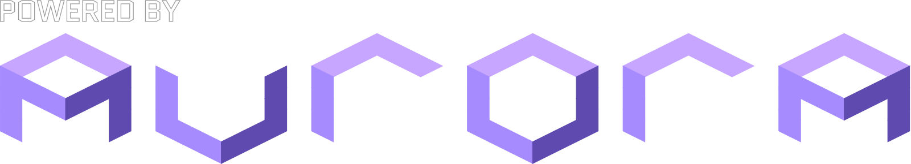

<div align="center">
  

  <h3>PartyBoard Beta 1.2</h3>

  <p>Mario Party 4 on Mac and Windows, with 8-player parties and online play.</p>

  <p>
    <a href="#download"><b>Download</b></a> ·
    <a href="#quick-start">Quick start</a> ·
    <a href="#playing-online">Playing online</a> ·
    <a href="#known-issues">Known issues</a> ·
    <a href="#building-from-source">Building</a>
  </p>
</div>

PartyBoard Beta is based on [PartyBoard](https://github.com/mariopartyrd/partyboard), the native PC port of
Mario Party 4. It adds 8-player parties, online play between Macs and PCs, and phones as controllers.

> [!IMPORTANT]
> **The game itself is not included.** You need your own **Mario Party 4** GameCube disc image. See [What you need](#what-you-need).

## Download

|  | **Mac** | **Windows** |
| --- | --- | --- |
| **Download** | [**PartyBoard-Beta-Mac.zip**](https://github.com/PaulGitHitGub/PartyBoard/releases/latest/download/PartyBoard-Beta-Mac.zip) | [**PartyBoard-Beta-Windows.zip**](https://github.com/PaulGitHitGub/PartyBoard/releases/latest/download/PartyBoard-Beta-Windows.zip) |
| **Computer** | Mac with Apple silicon (M1 or newer) | 64-bit PC (x64) |
| **System** | macOS 11 Big Sur or newer | Windows 10 or Windows 11 |
| **Graphics** | Metal (built in) | Direct3D 12 graphics card (Vulkan also works) |
| **Not supported** | Intel Macs | Windows on ARM, 32-bit Windows |

Beta 1.2 passed fresh eight-seat, ten-round Mac/Windows tests on all six boards, plus drop/Continue and extracted-download checks. New profiles use 1× internal resolution and 1× shadows. Friends, Achievements and RetroAchievements settings have been removed; Tailscale and phone controllers are retained.

All downloads are on the [Releases page](https://github.com/PaulGitHitGub/PartyBoard/releases).
Nothing to install: unzip and run.

### First launch on Mac

The app isn't notarized by Apple, so macOS blocks it the first time.

1. Unzip the download and move **PartyBoard Beta** to your Applications folder.
2. Open it. macOS says it can't verify the app. Click **Done**.
3. Open **System Settings → Privacy & Security**, scroll down and click **Open Anyway** next to "PartyBoard Beta". Confirm with your password.

On macOS 14 Sonoma or older you can instead right-click (Control-click) the app, choose **Open**, then **Open** again.
You only need to do this once.

### First launch on Windows

The program isn't signed, so Windows SmartScreen warns you the first time.

1. Right-click the zip, choose **Extract All**, and open the extracted **PartyBoard Beta** folder. Keep all its files together.
2. Double-click **partyboard.exe**.
3. If you see "Windows protected your PC", click **More info**, then **Run anyway**.

If **Smart App Control** blocks it instead, PartyBoard can't run while Smart App Control is on.

## What you need

- **Your own Mario Party 4 disc image.** The USA version, revision 1 is the one PartyBoard is tested with.
  USA revision 0 and the European version also load. The Japanese version is not supported.
  Accepted files: `.iso`, `.gcm`, `.ciso`, `.gcz`, `.rvz`, `.wbfs`, `.wia`, `.nfs`, `.tgc`.
  You can make one from your own disc, for example by following
  [Dolphin's guide to ripping games](https://dolphin-emu.org/docs/guides/ripping-games/).
  We can't provide or link the game.
- **A controller** (Xbox, PlayStation, Switch Pro and most others work), a keyboard, or a phone.
- For **online play**: [Tailscale](https://tailscale.com/download) on every computer (free for personal use).
- For **phones as controllers**:
  - Mac: Apple's Command Line Tools (open Terminal and run `xcode-select --install`).
  - Windows: [Python 3](https://www.python.org/downloads/windows/) (3.7 or newer).

## Quick start

1. Download and open PartyBoard Beta for your computer (see [Download](#download)).
2. Choose **Select Disc Image** and pick your Mario Party 4 file. PartyBoard checks it and remembers it.
3. Start the game. Press **F1** at any time for the PartyBoard menu (on some Mac keyboards **Fn + F1**).
4. For more than one player: **Players → Set Up Players**, and each person holds **L + R** on their controller in turn.

Saves and settings are kept in `~/Library/Application Support/MarioPartyRD/Party Board` (Mac) or
`%APPDATA%\MarioPartyRD\Party Board` (Windows). Keep that folder when you update.

## Features

**PartyBoard Beta 1.2**

- **8-player parties.** Party Mode now has an 8-player option as Battle Royale or Tag Battle (4 teams of 2).
  Minigames are played in two groups of four that change each round, so everyone faces everyone about equally.
  All six boards passed automated eight-player, ten-round tests; some event and controller combinations remain unverified.
- **Online play, Mac and Windows together.** Play over [Tailscale](https://tailscale.com) with up to 8 players.
  Several people can share one computer, for example 4 on a Mac and 4 on a PC.
- **Pause for everyone.** In online games, any player can pause the game for all players.
- **Continue an online party.** Resume from a saved results checkpoint. Any participating computer with the save can host and send it to the others. One saved online party slot is kept. Missing computers can be replaced by Hard computer players.
- **Keep playing after a disconnect.** Remaining people can hold START to vote to replace a disconnected computer's players with Hard computer players. The replacement is remembered when continuing later.
- **Phones as controllers.** The retained helpers support up to 4 phones on Mac and 8 on Windows, joining with a link or QR code. Phone input was not hands-on tested for this release.
- **Upscaled textures.** Sharper boards, characters and menus, included in the download.
- **Controller button prompts** in the game show Xbox, PlayStation or Switch buttons to match your controller.

**From PartyBoard (upstream)**

- A native PC port, not an emulator.
- Widescreen with an adaptive HUD, or locked 4:3.
- Any resolution, from the original 640×480 up to 4K and beyond (Settings → Video → Internal Resolution). It works online too, and each player can pick their own.
- Higher frame rates, VSync, fullscreen or windowed.
- Modern controllers and keyboard, with remapping.
- Extras such as unlock-all-minigames and a speedrun mode.

## Playing online

Online play sends only button presses. Every computer runs the whole game, so everyone needs the **same
PartyBoard Beta download** and the **exact same disc image file**.

1. **Join one Tailscale network.** Everyone installs [Tailscale](https://tailscale.com/download) and signs in.
   The host [invites the others](https://tailscale.com/docs/reference/inviting-vs-sharing) into their network
   (see Tailscale's [quickstart](https://tailscale.com/docs/how-to/quickstart)).
2. **Host:** open **Play Online** (on the start screen or in the F1 menu). Set your nickname and disc image,
   choose the party (4-player or 8-player), the number of players, and how many of them are **on this computer**.
   Then choose **Host a game**.
3. **Everyone else:** open **Play Online**, set nickname, disc image and **on this computer**, choose
   **Find games**, and pick the host's game.
4. **Ready up:** each player presses **A** on their own controller. When everyone is ready, the host chooses **Start game**.
5. Each game restarts into the online session a few seconds later. That's normal.

On Windows, if the firewall asks about PartyBoard, tick **Private networks** and choose **Allow access**.

## Known issues

This is a beta. Please report problems on the [Issues page](https://github.com/PaulGitHitGub/PartyBoard/issues),
with the logs from **Settings → Interface → Send Logs** (open Settings from the start screen or F1 menu).

- **Not play-tested by real groups yet.** 8-player parties and online games have passed long automated tests
  with computer players, but not yet a full game with real people, controllers and internet connections.
- **Intel Macs are not supported.** Only Macs with Apple silicon.
- **Windows has had less testing than the Mac**, especially with real controllers, sound and online play.
- **Online needs identical files.** The lobby turns away players whose PartyBoard version or disc image file
  differs, even if it's the same game in another format.
- **No mid-game rejoining by a disconnected computer.** Remaining people can vote to replace its players with Hard computer players. The saved party can be continued later.
- Online games run at 60 FPS and in 4:3; higher frame rates and widescreen are offline only. Resolution and the upscaled textures work online too.
- Physical controllers, audible sound, Windows desktop D3D12, phones and a full friends' party were not hands-on tested for Beta 1.2. Automated checks used scripted inputs and dummy audio.

## Building from source

The source is in [`PartyBoard-build/`](PartyBoard-build). Follow upstream's
[build instructions](PartyBoard-build/building.md), then turn on the options the release uses:

```sh
cd PartyBoard-build
cmake --preset <your platform preset> -B build/release \
  -DPARTYBOARD_EXPERIMENTAL_MUSYX_AUDIO=ON -DPARTYBOARD_NO_FMA=ON -DPARTYBOARD_SHARED_MATH=ON \
  -DPARTYBOARD_HD_BETA=ON -DPARTY_BOARD_ENABLE_SENTRY_NATIVE=OFF -DPARTYBOARD_RELEASE_VERSION=1.2
cmake --build build/release
cmake --install build/release
```

`PARTYBOARD_EXPERIMENTAL_MUSYX_AUDIO` gives the game its sound. `PARTYBOARD_NO_FMA` and
`PARTYBOARD_SHARED_MATH` make Mac and Windows builds compute the game identically, which online
play between them needs. A build you make yourself can only play online with copies of the same build.

## Credits

- [PartyBoard](https://github.com/mariopartyrd/partyboard) and all its
  [contributors](https://github.com/mariopartyrd/partyboard/graphs/contributors): the PC port this project is built on.
  Their credits include the GameCube/Wii decompilation community, the Dusk developers,
  [ImWhoreHay](https://x.com/ImWhoreHay) for the font, and justcamtro for the assets.
- The [Mario Party 4 decompilation](https://github.com/mariopartyrd/marioparty4) project.
- [Aurora](https://github.com/encounter/aurora), [decomp-toolkit](https://github.com/encounter/decomp-toolkit)
  and [nod](https://github.com/encounter/nod) by Luke Street.
- [MusyX](https://github.com/AxioDL/musyx) (AxioDL) and [libco](https://github.com/higan-emu/libco).
- [SDL](https://www.libsdl.org), [Dawn](https://dawn.googlesource.com/dawn), [RmlUi](https://github.com/mikke89/RmlUi)
  and the other libraries listed in [NOTICE.md](NOTICE.md).

<div align="center">
  <a href="https://github.com/encounter/aurora">
    
  </a>
</div>

## Legal

You must own Mario Party 4 and use a disc image you made yourself. The game is never included.

This project is not affiliated with or endorsed by Nintendo or Hudson Soft.
Mario Party and all related names and characters are trademarks of Nintendo.

Licence: GPL-2.0-or-later, see [LICENSE](LICENSE) and [NOTICE.md](NOTICE.md).
